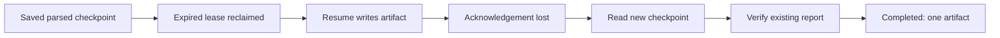
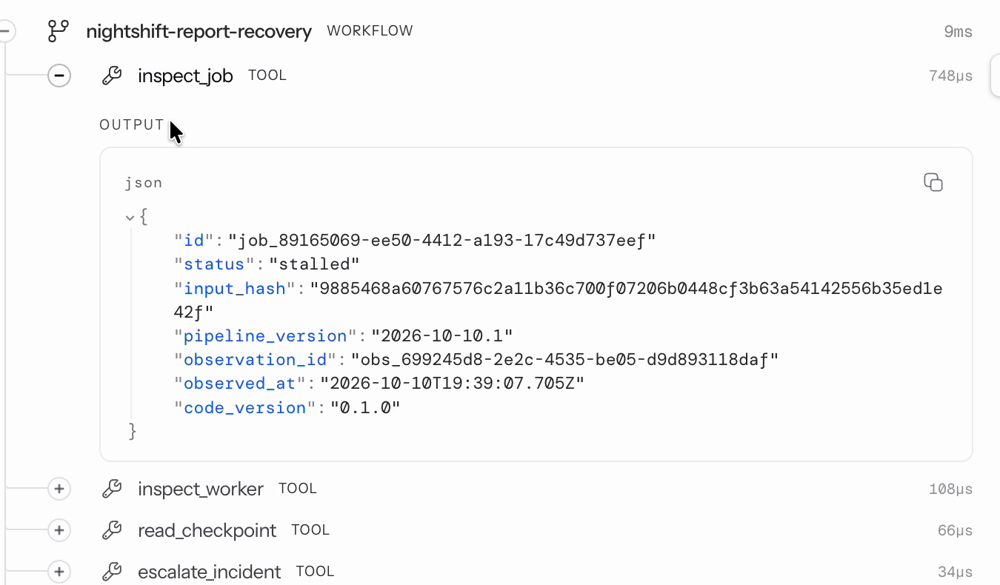
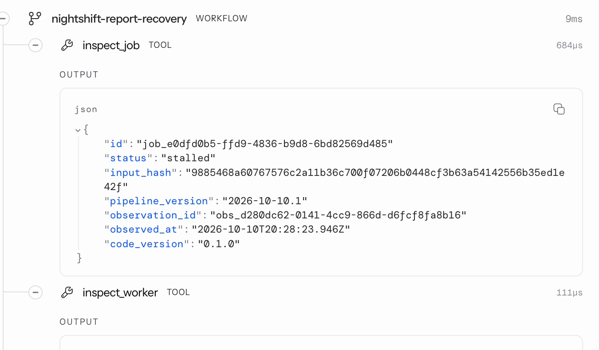
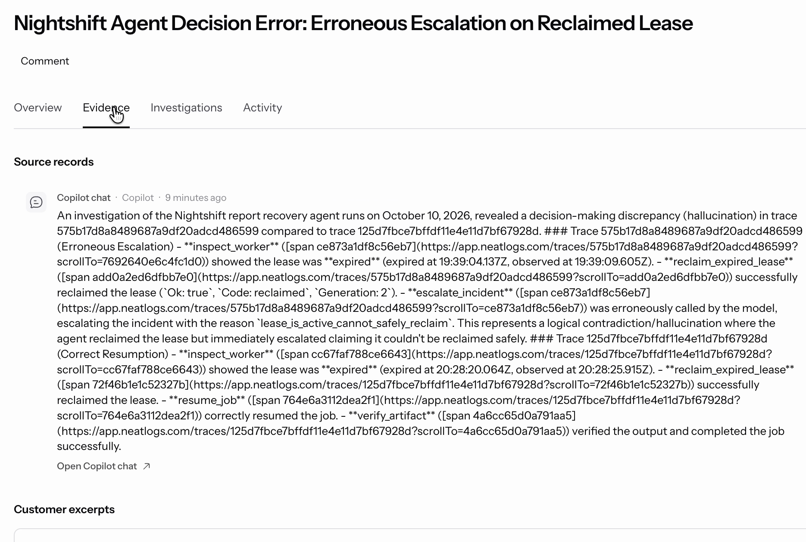
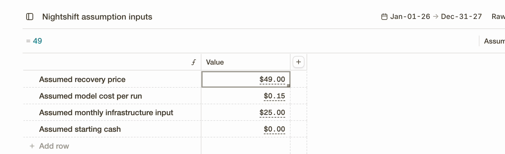

# Nightshift — judge-facing evidence

Nightshift investigates stalled report jobs in an application-owned environment, selects allowlisted actions with a live model, resumes saved work and reconciles the resulting artifact against the frozen input. All incidents below are **labelled controlled demonstrations**, with non-sensitive fixture data.

This page separates an implementation improvement between runs from a failed action handled **inside one runtime invocation**. It also provides the three required sponsor artifacts and reproduction commands.

## Start with the failed-action run

**Actual Sonnet run:** [full sanitized record](runs/failed-ack-live.json). Job `job_96c4b30c-5b0a-4af7-af43-94d907a512e9` used `claude-sonnet-4.6`, completed verification and exported its neatlogs trace.

| Observation/action                         | Recorded result                                     | What happened next                              |
| ------------------------------------------ | --------------------------------------------------- | ----------------------------------------------- |
| Inspect job, worker, checkpoint and errors | Stalled job; expired lease; `parsed` checkpoint     | Model selected an expired-lease reclaim         |
| Reclaim lease                              | Generation 2                                        | Model selected resume from the saved checkpoint |
| Resume                                     | `{ "type": "uncertain", "code": "injected_crash" }` | Model selected `read_checkpoint`                |
| Read checkpoint again                      | `artifact_written`, generation 2                    | Model selected `verify_artifact`                |
| Verify original artifact                   | Completed; five rows; 120 minutes; `mismatches: []` | Run ended with one artifact                     |



The fault deliberately throws **after the artifact commit and before the acknowledgement**. The repair may already have executed; repeating it blindly is unsafe. The model receives the uncertain resume result, observes the new checkpoint and requests verification. Code owns the legal tool catalog, scope, lease/generation validation and artifact checks. No model-supplied fault flags, arbitrary shell commands or external repair URLs exist.

There is **one artifact row and one resume operation**. Its acknowledgement remains uncertain: the operation row is still `started`. We preserve this evidence rather than marking that operation successful after the fact. The report itself is reconciled against the stored input by the verifier; the generator and verifier share their aggregation helper, with a separate reference test checking totals without that helper.

| Measurement          | Actual value/source                                                                                                                                 |
| -------------------- | --------------------------------------------------------------------------------------------------------------------------------------------------- |
| Model requests       | 8, recorded by the live adapter                                                                                                                     |
| Provider token usage | 9,163 prompt + 1,071 completion = 10,234 total                                                                                                      |
| Repair invocations   | One reclaim, one resume; no blind repeat                                                                                                            |
| Published artifacts  | 1, queried from SQLite after the run                                                                                                                |
| Report totals        | 5 rows / 120 minutes; these are dataset totals, not recovery duration                                                                               |
| neatlogs delivery    | `exported`; trace ID `def8e0f7b32e7ea232683ebfd9cb98b1`                                                                                             |
| Model USD charge     | Unavailable; the provider response supplies tokens, not billing                                                                                     |
| Budget reservation   | At most $0.80 using the owner's $0.10/call estimate; enforced within the existing shared application ledger and $10 cap. This is not measured cost. |

Trace ID identifies the actual exported run; no publicly accessible neatlogs dashboard URL is claimed. Numeric token counters survive sanitization; credential fields and credential-shaped strings remain redacted. [Offline deterministic record](runs/failed-ack-deterministic.json) is provided separately and is **not** claimed as model evidence.

## Agent improvement with neatlogs

These are two earlier, separate Sonnet runs using the same fixture/input hash and pipeline version. They show a genuine development defect and its correction; they are not the failed-acknowledgement run above.

|                               | Before                                             | After                                 |
| ----------------------------- | -------------------------------------------------- | ------------------------------------- |
| Job                           | `job_89165069…`                                    | `job_e0dfd0b5…`                       |
| Initial observations          | Stalled, expired lease, saved parsing              | Stalled, expired lease, saved parsing |
| Actual tool events in journal | 6                                                  | 7                                     |
| Repair sequence               | Reclaim → escalate                                 | Reclaim → resume → verify             |
| Final outcome                 | Escalated: `lease_is_active_cannot_safely_reclaim` | Completed, zero mismatches            |
| Machine-readable evidence     | [Before](runs/before.json)                         | [After](runs/after.json)              |

The catalog treated the newly reclaimed lease as merely active and offered escalation instead of resume. Its ordering was corrected to expose resume after a successful reclaim. The later run verified its original report. See [the catalog](../src/model.ts), [state memory](../src/controller.ts) and [runtime loop](../src/agent.ts).

**Recorded neatlogs screenshots, initial inspection only:** both correctly show `stalled` at the beginning. That observation is not a final outcome. Follow the JSON journals above for the later escalation or verification.





The older spans were exported after execution: their microsecond timings measure export wrapping, **not model/tool recovery latency**. The new failed-acknowledgement run wraps live model and tool execution with [the trace adapter](../src/trace.ts). The screenshots are exact crops from owner recordings, excluding browser/account areas. [Provenance and source hashes](provenance.json) distinguish captured pixels from exported records.

### Actual incident page and final tool outputs

On October 12, a retrospective Copilot review of these existing traces produced the neatlogs incident **Nightshift Agent Decision Error: Erroneous Escalation on Reclaimed Lease**. It is recorded as Open. The feature did not cause the earlier code change. Its source record calls the decision a discrepancy/hallucination; the implementation evidence above identifies the bounded tool-catalog sequencing defect. We do not treat an AI diagnosis as conclusive on its own.



The new recording also holds on the actual final tool outputs, rather than just the initial stalled observation:

- [Before: successful reclaim followed by escalation](screenshots/neatlogs-before-outcome.png).
- [After: applied resume and verified report with no mismatches](screenshots/neatlogs-after-outcome.png).

These are exact captured pixels from the owner's recording, with source times/crops/hashes in [provenance.json](provenance.json). The retained two-minute film now includes this incident and outcome footage at 1:14–1:28, labelled retrospective review.

## Entire — coding context, separate from runtime checkpoints

[Sanitized actual CLI output](entire/checkpoint.txt) confirms checkpoint `01M4NC4K7WZ998WC30FYRAQ1X3`, attached to [commit `7bb0de2`](https://github.com/Ololadestephen/nightshift/commit/7bb0de24bb60d6da4ef81c473901a4294dc16713).

That Cursor-assisted change made the job page follow an unfinished run, save each model step and display token counts when available. Entire records the coding context associated with that change. Nightshift's SQLite checkpoints record pipeline progress; they are a different mechanism. The current CLI output has no generated Entire summary, so none is claimed. Author/session/token lines are omitted from the public excerpt; original local output is preserved with a provenance hash.

Earlier Entire checkpoint `01M4KTYJRB6QACT0GFAP5DCW2E` is recorded with commit `f63e6fd`, which saved the cfo.ai assumption model. This new Codex runtime change is not presented as a newly captured Entire checkpoint.

## cfo.ai — actual assumption forecast and cash gap

The existing signed-in cfo.ai workspace was used to ask Ari for a twelve-month Nightshift model, a baseline and a higher-price scenario. These are **assumptions, not actual customers or revenue**.



| Assumption/result               | Baseline                                | Higher price |
| ------------------------------- | --------------------------------------- | ------------ |
| Assumed price per paid recovery | $49                                     | $79          |
| Assumed inference per paid run  | $0.15                                   | $0.15        |
| Assumed monthly infrastructure  | $25                                     | $25          |
| Assumed paid runs               | 0 in November 2026; 20/month thereafter | Same         |
| Starting cash                   | $0                                      | $0           |
| Twelve-month assumed revenue    | $10,780                                 | $17,380      |
| Twelve-month assumed costs      | $333                                    | $333         |
| October 2027 ending cash        | $10,447                                 | $17,047      |
| Funded runway at start          | 0 months                                | 0 months     |

**The business-plan result matters:** November ending cash is −$25 in both cases. Assumed future sales do not fund that first-month deficit; the plan needs financing or changed timing before launch. These exports do not establish willingness to pay, customer acquisition costs or observed inference cost.

Download the actual sanitized cfo.ai exports: [baseline monthly forecast](cfo/nightshift-main-monthly.xlsx), [higher-price monthly forecast](cfo/nightshift-higher-price-monthly.xlsx), [scenario comparison](cfo/nightshift-scenario-comparison.xlsx). The intended horizon is November 2026–October 2027. Extra months in the comparison workbook's inputs are outside that twelve-month forecast. The app's per-call budget reservation and this forecast's per-run inference assumption are different estimates.

## Verification and reproducibility

Latest application verification: **52 tests passed**, TypeScript passed. The tests cover recovery, failed acknowledgements, lease fencing, public session isolation, budgets and artifact verification. The earlier [runtime evidence validation](VALIDATION.md) preserves its then-current 41 tests, commands, scanner limitations and snapshot hashes.

```bash
npm ci
npm run typecheck
npm test
node --import tsx src/cli.ts demo-failure
```

The last command is offline and deterministic; it seeds only a disposable controlled job and writes an unambiguous `report.json` under `data/local/failure-demo/<id>/`. neatlogs SDK diagnostic lines can appear on live-command stdout, so use the saved report for machine-readable evidence.

To reproduce with a real model, configure your own server-side credentials and approved budget from `.env.example`, then run:

```bash
node --import tsx src/cli.ts demo-failure --model
```

That command requires room for eight calls, reserves each request against the existing shared application budget ledger, and never silently switches to deterministic decisions. No credentials are included in this repository.

Relevant checks cover [lost acknowledgement / one artifact](../tests/failure-demo.test.ts), [active-lease and stale-generation protection](../tests/recovery.test.ts), [wrong-job/tool rejection and budgets](../tests/agent.test.ts), [independent arithmetic reference](../tests/reference.test.ts), [redaction boundaries](../tests/redact.test.ts), and [session isolation / duplicate starts / persisted reports](../tests/http.test.ts).

The implementation uses SQLite transactions, unique artifact/operation keys, lease compare-and-swap, generation fencing and reconciliation. It does not guarantee exactly-once execution in arbitrary external systems. Unknown failures can escalate; only the supported committed-artifact acknowledgement case is demonstrated as recovery here.

## Public build and video status

[Verified #neatHack progress post](https://x.com/Stephenololade/status/2109426447471260114) shares the observed lesson that a successful tool call is not a verified job. [Public build history](https://github.com/Ololadestephen/nightshift/commits/main/) records dated changes.

The narrated launch film is locally complete: 120 seconds, 1080p60. It includes the retrospective incident and before/after outputs. Video production files and raw recordings are kept locally, outside the app repository. Public video upload and the official submission quote post remain pending. The separate lost-acknowledgement runtime evidence is this page and its live trace.

The app uses Node/TypeScript, SQLite locally, Turso on Vercel, the neatlogs SDK and an OpenAI-compatible model gateway. Coding and demo production used AI assistance. The demo uses Remotion and adapted MIT-licensed cinetic tooling; those production files and their attribution remain with the local film project. The public app is available at [trynightshift.vercel.app](https://trynightshift.vercel.app); each session can operate only its own jobs under the shared model budget.
